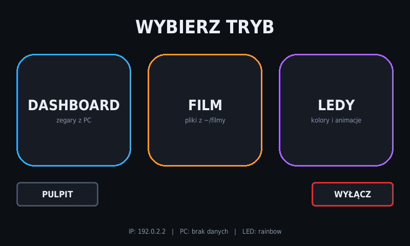
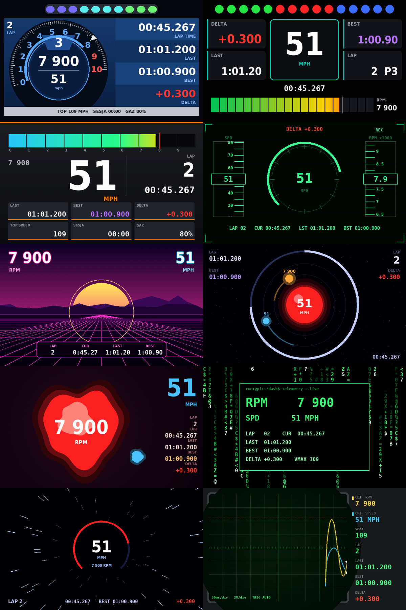
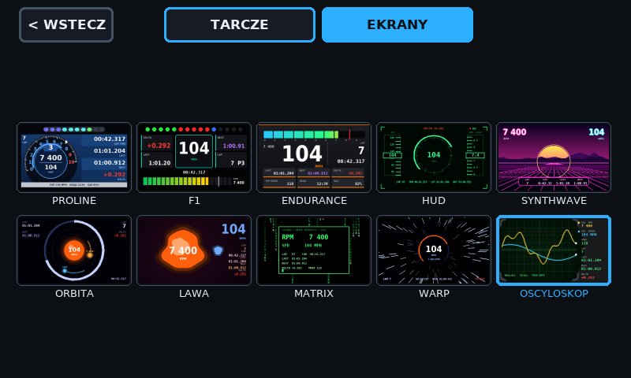
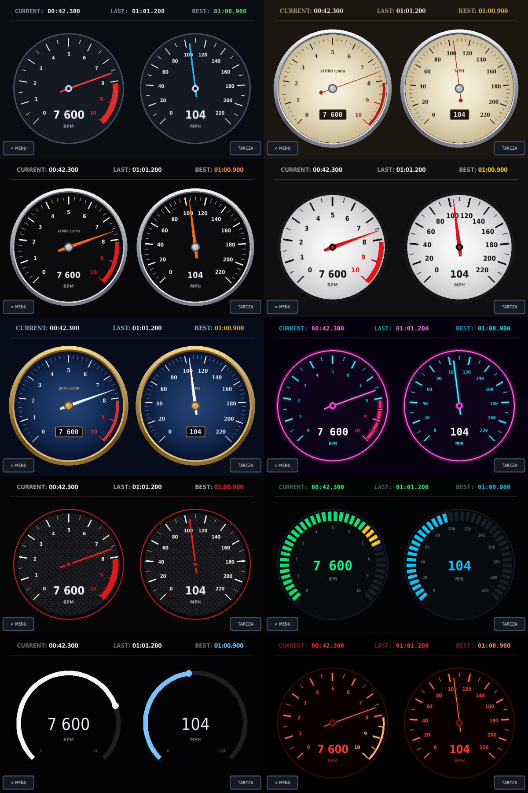
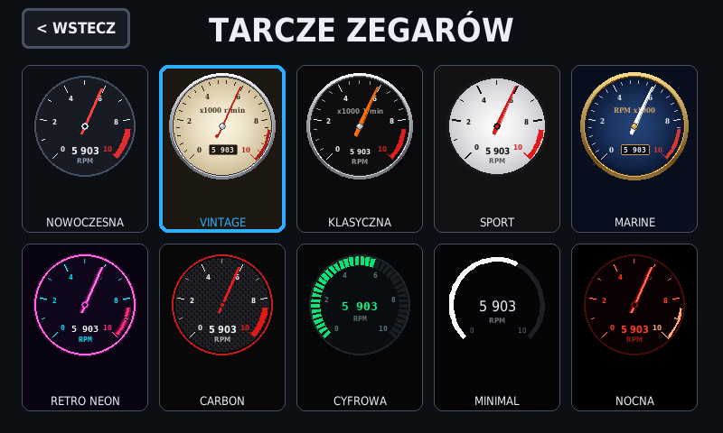

# raspberry_sim_dashboard

Raspberry Pi z ekranem jako deska rozdzielcza do symulatora HydroSim, odtwarzacz filmów i sterownik taśmy LED WS2812.

Po włączeniu RPi pokazuje się menu: **DASHBOARD / FILM / LEDY**. Filmy i LEDy działają bez komputera. PC jest potrzebny tylko do dashboardu, bo stamtąd przychodzi telemetria.



## Co gdzie działa

| | Raspberry Pi (`raspberry/`) | PC z Windows (`pc/`) |
|---|---|---|
| Menu startowe | `launcher.py` (autostart po zalogowaniu) | – |
| Dashboard | `launcher.py` + tarcze (`themes.py`) i pełne ekrany (`layouts.py`), dane UDP :5005 | `DASHBOARD.py` czyta HydroSim i wysyła telemetrię |
| Film | `launcher.py` + VLC, pliki z `~/filmy`, uruchamiany z ekranu dotykowego | – |
| LEDy | `ledd.py` – usługa systemd, działa od startu | `LED.py` – opcjonalne sterowanie z konsoli |

```
 PC (Windows)                         Raspberry Pi
 ┌──────────────┐  UDP 5005   ┌───────────────────────┐  UDP 5006  ┌─────────┐
 │ DASHBOARD.py ├────────────►│ launcher.py (pygame)  ├───────────►│ ledd.py ├─► SPI ─► WS2812
 │              │ telemetria  │ menu/dashboard/film   │ ustawienia │ (systemd)│
 └──────────────┘ + komendy   └───────────┬───────────┘ + RPM      └─────────┘
 ┌──────────────┐  UDP 5006                │ uruchamia                  ▲
 │ LED.py       ├──────────────────────────┼────────────────────────────┘
 └──────────────┘                          ▼
                                          VLC (~/filmy)
```

SSH nie jest już potrzebne. PC przełącza RPi w tryb dashboardu komendą UDP, a po zamknięciu `DASHBOARD.py` RPi wraca do menu.

## Instalacja na Raspberry Pi

```bash
git clone https://github.com/KoperekPL/raspberry_sim_dashboard.git
cd raspberry_sim_dashboard/raspberry
bash install.sh        # bez sudo
sudo reboot
```

Bez gita (instalacja albo aktualizacja):
```bash
cd ~ && wget -O rsd.zip https://github.com/KoperekPL/raspberry_sim_dashboard/archive/refs/heads/main.zip
unzip -o rsd.zip && cd raspberry_sim_dashboard-main/raspberry && bash install.sh
```
Jeśli `git` albo `wget` zgłasza błąd certyfikatu, sprawdź datę na RPi (`date`). Jeśli jest zła, ustaw ją: `sudo timedatectl set-ntp true` albo `sudo date -s "2026-11-26 14:30"`.

Skrypt instalacyjny:
- instaluje `python3-pygame`, `python3-spidev` i `mpv`,
- włącza SPI i ustawia stały zegar rdzenia na Pi 4 (bez tego taśma LED migałaby),
- tworzy usługę `ledd` i dodaje menu do autostartu pulpitu,
- włącza automatyczne logowanie do pulpitu.

Filmy wrzucasz do `~/filmy` (`.mp4 .mkv .mov .avi .webm .m4v`). Jeśli jest tylko jeden film, odpali się od razu. Przy kilku pokaże się lista. Film zamykasz podwójnym dotknięciem albo klawiszem ESC.

Konfiguracja jest na górze plików:
- `launcher.py`: `FILM_LOOP`, `FILM_MUTE`, `AUTO_DASHBOARD` (sam przechodzi do dashboardu, gdy przyjdą dane z PC)
- `ledd.py`: `NUM_LEDS`, `COLOR_ORDER`, `MAX_BRIGHTNESS`

Po zmianie konfiguracji skopiuj pliki do `~/pi-launcher/` (albo uruchom `install.sh` jeszcze raz) i wykonaj `sudo systemctl restart ledd`.

## Podłączenie taśmy WS2812

| RPi | Taśma |
|---|---|
| GPIO10 / MOSI (pin 19) → konwerter 3.3→5 V (np. 74AHCT125) → rezystor 330 Ω | DIN |
| GND (np. pin 20) | GND (wspólna masa z zasilaczem!) |
| – | +5 V z **osobnego** zasilacza (≈60 mA na diodę przy pełnej bieli) |

Przy taśmie warto dać kondensator 1000 µF między +5 V a GND. `MAX_BRIGHTNESS` w `ledd.py` ogranicza maksymalny prąd.

Działa na Pi 3, 4 i 5. Używa SPI, więc nie potrzebuje roota i nie koliduje z dźwiękiem, inaczej niż biblioteka `rpi_ws281x`, która na Pi 5 nie działa.

## Na PC

- `DASHBOARD.py`: tak jak wcześniej (potrzebny `hydrosim_sdk`). Przy starcie przełącza RPi na dashboard, przy zamknięciu wraca do menu.
- `LED.py`: np. `python LED.py rainbow`, `python LED.py static --color ff0000 --brightness 0.3`, `python LED.py status`.

W każdym skrypcie ustaw `RPI_IP`. Zapora Windows musi przepuszczać wychodzące UDP (zwykle przepuszcza).

## Ekrany dashboardu

Do wyboru jest 20 skórek, podzielonych na dwie zakładki:
- **TARCZE**: klasyczne dwa zegary w 10 stylach,
- **EKRANY**: 10 pełnoekranowych układów.

Wyboru dokonujesz:
- w menu przyciskiem **TARCZE**,
- na dashboardzie po dotknięciu ekranu: pojawiają się przyciski **< MENU / NASTĘPNY / EKRAN**, które chowają się po 4 sekundach,
- z PC: ustaw `THEME` w `DASHBOARD.py` albo wyślij `{"cmd": "theme", "name": "warp"}` (zamiast nazwy możesz podać `"next"` lub `"prev"`).

Wybór zapisuje się w `~/.config/pi-launcher/settings.json`.

### Pełne ekrany



| Nazwa | Opis |
|---|---|
| **PROLINE** (`proline`) | wyświetlacz wyścigowy: shift-light, półokrągły obrotomierz, pasy z czasami, linia info |
| **F1** (`f1`) | ekran z kierownicy: 15 diod (zielone/czerwone/niebieskie), delta, pasek RPM |
| **ENDURANCE** (`endurance`) | prototyp LMP: pasek obrotów na całą szerokość, ogromna prędkość, 6 kafli z danymi |
| **HUD** (`hud`) | wyświetlacz przezierny myśliwca: przewijane taśmy prędkości i obrotów, celownik, „>> SHIFT <<” |
| **SYNTHWAVE** (`synthwave`) | neonowy zachód słońca, siatka pędzi z prędkością łodzi, przy redline zmienia kolor |
| **ORBITA** (`orbit`) | planeta rozgrzewa się z obrotami, księżyce krążą z prędkością RPM i MPH, pierścień postępu okrążenia |
| **LAWA** (`lava`) | pulsujący blob, który rośnie, faluje i czerwienieje z obrotami, a satelita pokazuje prędkość |
| **MATRIX** (`matrix`) | deszcz znaków pada szybciej przy większej prędkości, przy redline robi się czerwony |
| **WARP** (`warp`) | skok w nadprzestrzeń, gwiazdy wydłużają się z prędkością |
| **OSCYLOSKOP** (`scope`) | ostatnie 10 s obrotów i prędkości jako przebiegi na ekranie CRT |



Numer okrążenia, deltę (ostatnie okrążenie minus najlepsze), prędkość maksymalną i czas sesji liczy RPi. Gaz i pozycję `DASHBOARD.py` wysyła tylko wtedy, gdy SDK je udostępnia. Jeśli nie, w ich miejscu pojawia się „--” albo inne dane.

Nowy ekran dodajesz, pisząc funkcję `draw_xxx(surf, d, now, dt)` w `layouts.py` i dopisując ją do `LAYOUTS`. Tło rysuj przez `cached_bg`, a co klatkę tylko zmienne elementy.

## Tarcze zegarów

Do wyboru jest 10 tarcz: **NOWOCZESNA, VINTAGE, KLASYCZNA, SPORT, MARINE, RETRO NEON, CARBON, CYFROWA, MINIMAL, NOCNA**.





Własną tarczę dodajesz, dopisując słownik do listy `THEMES_OVERRIDES` w `themes.py`. Każdy parametr z `BASE` jest tam opisany: rodzaj tarczy (`flat` / `radial` / `carbon`), obręcz (`ring` / `chrome` / `brass` / `glow`), wskazówka (`line` / `taper` / `thin` / `glow`), łuk zamiast wskazówki (`progress` / `segments`), czcionki i kolory. Statyczna część zegara rysuje się raz i trafia do cache, więc nawet efektowne tarcze nie obciążają RPi.

## Tryby LED

`WYŁĄCZ`, `STAŁY`, `ODDECH`, `TĘCZA`, `CYKL KOLORÓW`, `KOMETA`, `ISKRY`, `OGIEŃ`, `POLICJA` oraz **`OBROTY (RPM)`**. Ten ostatni to shift-light: w trybie dashboardu pasek rośnie z obrotami (zielony → żółty → czerwony) i miga na niebiesko przy redline. Bez danych z PC delikatnie świeci wybranym kolorem.

Ustawienia zapisują się w `~/.config/ledd/state.json` i są przywracane po restarcie.

## Protokół (JSON po UDP)

Launcher, port **5005**:
```json
{"rpm": 6500, "max_rpm": 9000, "speed": 87, "unit": "MPH", "current_lap": 42.3, "last_lap": 61.2, "best_lap": 60.9}
{"cmd": "mode", "mode": "dashboard"}            // albo "menu"
{"cmd": "stop", "mode": "dashboard"}            // wraca do menu tylko, jeśli ten tryb jest aktywny
{"cmd": "theme", "name": "vintage"}             // nazwa tarczy/ekranu albo "next" / "prev"
// opcjonalne pola w pakiecie telemetrii: "throttle" (0..1), "position", "lap"
```
ledd, port **5006**:
```json
{"cmd": "set", "mode": "comet", "color": [0,120,255], "brightness": 0.5, "speed": 1.0}
{"cmd": "rpm", "rpm": 7200, "redline": 9000}
{"cmd": "get"}                                  // odpowiedź: {"state": {...}}
```

## Film

Film odtwarza **VLC** z tymi samymi parametrami co wcześniejszy skrypt filmu. VLC w Raspberry Pi OS jest przygotowane pod sprzętowe dekodowanie na RPi. Po wybraniu filmu przez około 2 sekundy widać czarny ekran „Ładowanie filmu…”, potem launcher oddaje odtwarzaczowi cały ekran.

Film zamykasz podwójnym dotknięciem ekranu albo klawiszem ESC. Launcher czyta dotyk bezpośrednio z `/dev/input` (`python3-evdev`, grupa `input`).

Ustawienia na górze `launcher.py`:
- `FILM_PLAYER = "vlc"`: możesz zmienić na `"mpv"` albo `"auto"`,
- `FILM_HANDOFF_DELAY`: czas czarnego ekranu,
- `VLC_EXTRA_ARGS` / `MPV_EXTRA_ARGS`: dodatkowe parametry odtwarzacza.

Jeśli film i tak się tnie, sprawdź kodek. Pi 5 dekoduje sprzętowo tylko H.265/HEVC, więc ciężki film H.264 albo 4K warto przekodować na PC:
`ffmpeg -i film.mp4 -c:v libx265 -crf 24 -preset medium -vf scale=-2:1080 -c:a aac film_hevc.mp4`

## Diagnostyka

- Logi menu: `~/.cache/pi-launcher.log`
- Logi LED: `journalctl -u ledd -f`
- Test menu w oknie na zwykłym komputerze: `LAUNCHER_WINDOW=800x480 python3 raspberry/launcher.py`
- Kolory zamienione (np. czerwony świeci na zielono): zmień `COLOR_ORDER` w `ledd.py`.
- Diody migają losowo: sprawdź konwerter poziomów, wspólną masę i to, czy wykonano reboot po instalacji (wymaga tego zmiana zegara SPI).
- Wyjście z menu na pulpit: przycisk **PULPIT**. Menu można potem uruchomić ponownie ze skrótu „Pi Launcher” w menu systemu.
